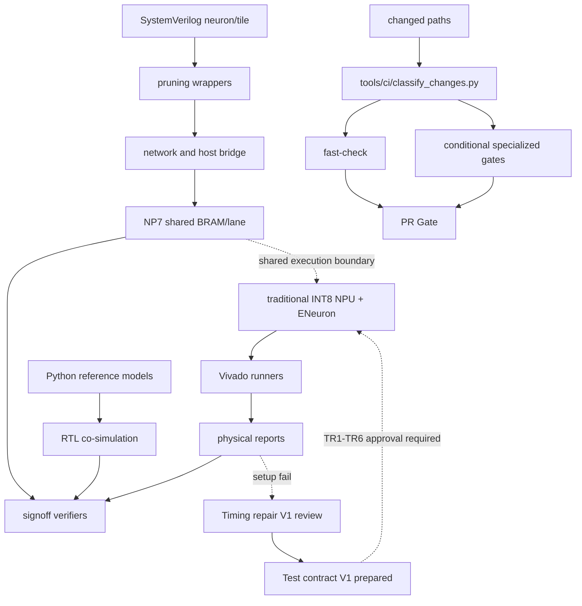

# 依赖关系

generated_by: nexus-mapper v2 / manual synthesis
verified_at: 2026-09-05
provenance: `.nexus-map/raw/ast_nodes.json` hub analysis and Python imports；SystemVerilog依赖由文件树/手工检查推断



```text
Python oracle → cosim runners → unittest/verifier
神经元 RTL → wrapper → Tile/network → Host bridge
local_prune_reference → local_prune wrappers/network → NP4B signoff
NP7 shared lane oracle → dense/sparse RTL → XSim/OOC runners → physical/evidence gates
Vivado Tcl/runner → reports → verify_goal
传统 NPU + ENeuron 集成材料包 → OF1-OF6 Python oracle 签核 → `RTL_DESIGN_CONTRACT_V2_APPROVED` → 模型/流骨架 → mask epoch 切片 → abort/clear/freeze 控制切片（三项 Icarus 各 1/1）→ 真实 MAC/mask 门控 → Python/Icarus 完整逐拍门 → Vivado OOC setup 失败证据 → `NPU_SINGLE_CLOCK_TIMING_REPAIR_V1` 审核 → `NPU_SINGLE_CLOCK_TIMING_REPAIR_TEST_CONTRACT_V1` 已准备（`PREPARED / BLOCKED_BY_TR1_TR6_APPROVAL`）→ TR1-TR6 批准后 RED 测试与 RTL 分拍实现 → C1-C4 定向 + 固定 `20×100` + 完整回归 → 同器件、同 100 MHz 约束 OOC 重跑
变更路径 → `classify-changes` → fast/全仓/XPM/NP7 专项门 → 唯一 `PR Gate`
```

高扇入模块包括 `pulse_mini_reference.py`、`rtl_tile_cosim.py`、`pulse_mini_l2_reference.py`、`neuron_sim.py`、`local_prune_reference.py`、`network_sim.py` 和 `host_bridge_oracle.py`。AST 仅覆盖 Python；RTL→wrapper→network 方向是人工核对的结构依赖。
