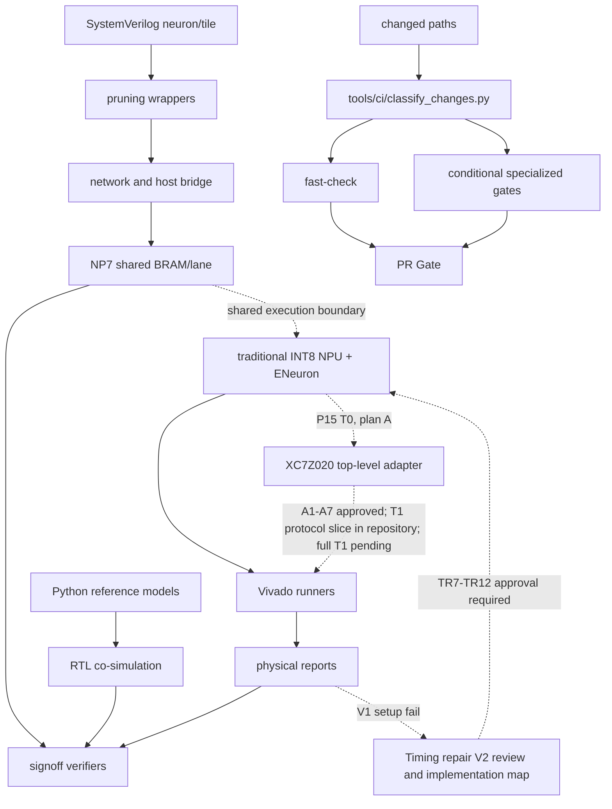

# 依赖关系

generated_by: nexus-mapper v2 / manual synthesis
verified_at: 2026-09-07
provenance: `.nexus-map/raw/ast_nodes.json` hub analysis and Python imports；SystemVerilog依赖由文件树/手工检查推断



```text
Python oracle → cosim runners → unittest/verifier
神经元 RTL → wrapper → Tile/network → Host bridge
local_prune_reference → local_prune wrappers/network → NP4B signoff
NP7 shared lane oracle → dense/sparse RTL → XSim/OOC runners → physical/evidence gates
Vivado Tcl/runner → reports → verify_goal
传统 NPU + ENeuron 集成材料包 → Python oracle 签核 → 单时钟 RTL 与随机门 → 旧 OOC setup 失败 → TR1-TR6 批准 → 四 DSP 三拍 RTL → 单时钟 8/8 + 固定 `20×100` + 完整 473 项 → DSP V1 OOC（恰好 4 DSP48E1，hold/route/DRC 通过，100 MHz setup `WNS=-0.673 ns / TNS=-6.462 ns / 22` 端点失败）→ `NPU_SINGLE_CLOCK_TIMING_REPAIR_V2` 审核与 `NPU_SINGLE_CLOCK_TIMING_REPAIR_V2_IMPLEMENTATION_MAP` → TR7-TR12 批准 → V2 OOC 100 MHz PASS → P15-T0 方案 A（128-bit 命令/响应 FIFO + 64-bit 样本 FIFO + 96-bit 结果 FIFO，AXI-Stream 在 FIFO 外）→ 只读审计形成 A1-A7 → 管理员批准 A1-A7，状态 `P15_T0_APPROVED / T1_RTL_AUTHORIZED` → T1 wrapper/testbench/XPM/manifest 已提交且协议切片可复现，T1 全量、T2 双时钟协同仿真与 T3 XC7Z020 OOC 待独立验收 → 第一次完整端到端跑通后才重新评审资源裁剪
变更路径 → `classify-changes` → fast/全仓/XPM/NP7 专项门 → 唯一 `PR Gate`
```

高扇入模块包括 `pulse_mini_reference.py`、`rtl_tile_cosim.py`、`pulse_mini_l2_reference.py`、`neuron_sim.py`、`local_prune_reference.py`、`network_sim.py` 和 `host_bridge_oracle.py`。AST 仅覆盖 Python；RTL→wrapper→network 方向是人工核对的结构依赖。
