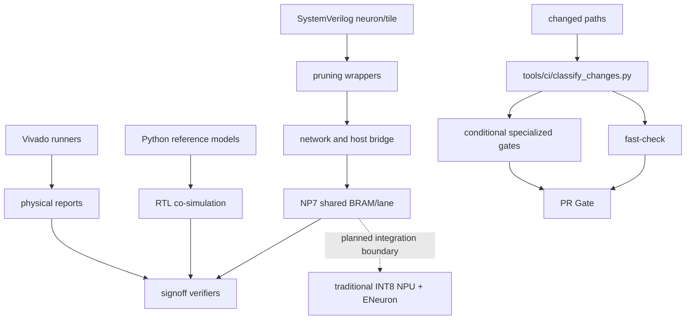

# 依赖关系

generated_by: nexus-mapper v2 / manual synthesis
verified_at: 2026-09-04
provenance: `.nexus-map/raw/ast_nodes.json` hub analysis and Python imports；SystemVerilog依赖由文件树/手工检查推断



```text
Python oracle → cosim runners → unittest/verifier
神经元 RTL → wrapper → Tile/network → Host bridge
local_prune_reference → local_prune wrappers/network → NP4B signoff
NP7 shared lane oracle → dense/sparse RTL → XSim/OOC runners → physical/evidence gates
Vivado Tcl/runner → reports → verify_goal
传统 NPU + ENeuron 集成材料包 → OF1a/OF1b/OF3 已绿 → OF4a 634-word 模型镜像 → `OF4B1_MASK_WORD_MAP_GREEN`（严格 19-word uint32 掩码镜像、512+80 bit、LSB-first、word18 保留位、oracle 27/27）→ `OF1-OF6_V3_IMPLEMENTATION_IN_PROGRESS` → 四态命令机、ready/valid、错误响应与 MODEL_COMMIT → 状态协议 → RTL 设计审核 → Vivado 证据
变更路径 → `classify-changes` → fast/全仓/XPM/NP7 专项门 → 唯一 `PR Gate`
```

高扇入模块包括 `pulse_mini_reference.py`、`rtl_tile_cosim.py`、`pulse_mini_l2_reference.py`、`neuron_sim.py`、`local_prune_reference.py`、`network_sim.py` 和 `host_bridge_oracle.py`。AST 仅覆盖 Python；RTL→wrapper→network 方向是人工核对的结构依赖。
