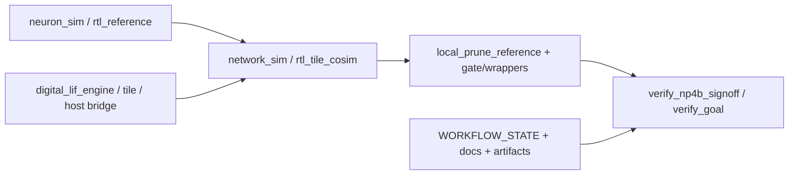

> generated_by: nexus-mapper v2
> verified_at: 2026-09-02
> provenance: AST-backed for Python imports; RTL links inferred from module instantiation and runner files

# 依赖关系

Python AST 的扇入中心是 `pulse_mini_reference.py`、`rtl_tile_cosim.py`、`pulse_mini_l2_reference.py`、`neuron_sim.py` 和 `local_prune_reference.py`。SystemVerilog 关系来自模块声明与协同仿真 runner 的人工核验，属于 inferred。
