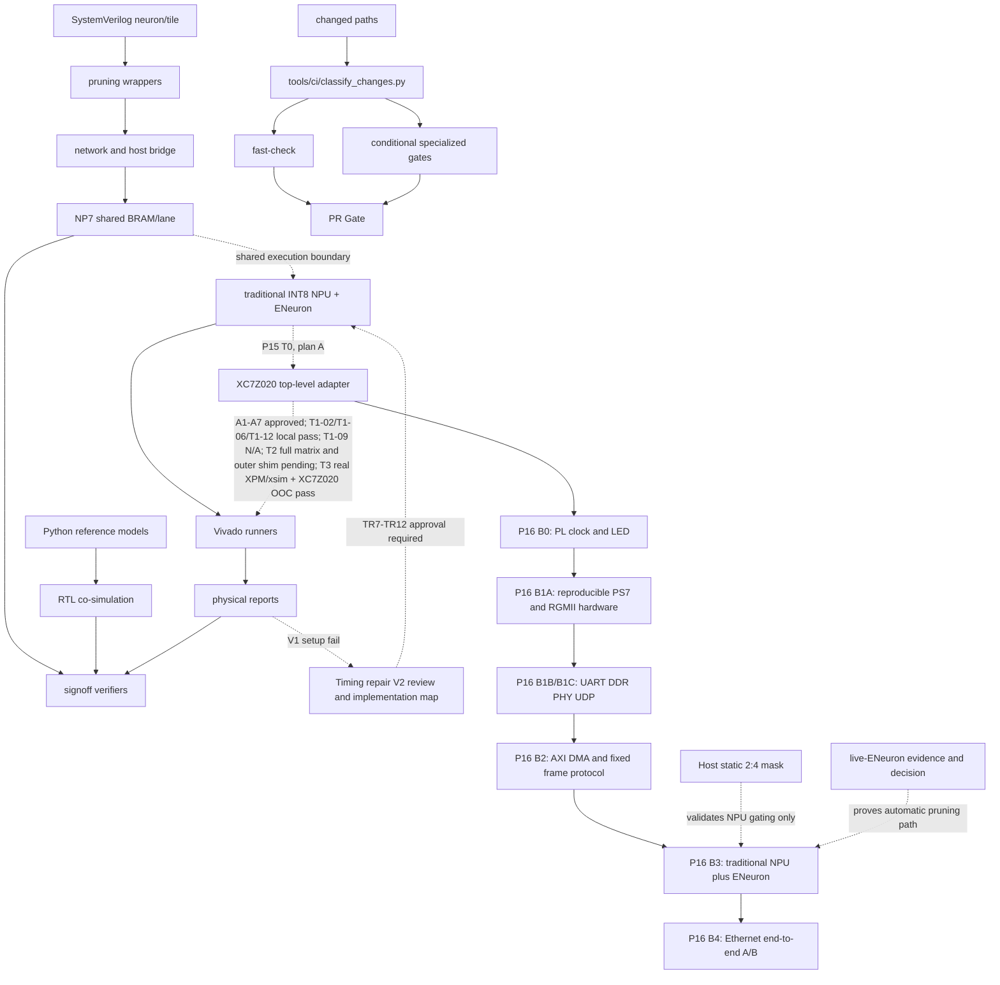

# 依赖关系

当前依赖边界：`xc7z020clg484-2` NPU + ENeuron 动态剪枝是活动主线；`archive/legacy/` 不参与日常门。B1 高地址 DDR、PHY、UDP 继续阻塞板卡 `B1-GATE` 和后续板级 B2，但在低地址窗口足以容纳模型/DMA 缓冲区时，不阻塞 NPU MVP 的 RTL/软件推进。旧 `clg400-1` NP7/T3 物理结果仅作历史参考。

B1依赖（2026-09-08）：B0实板配置链 → B1A来源审计与可重建硬件定义 → B1B UART/DDR实板门 → B1C PHY/UDP与最终B1-GATE。B1B的正式UART和低地址1 MiB DDR已三次冷启动通过，下一板卡依赖是关闭`0x10000000`高地址异常；在此之前不能完成B1C最终签核或板级B2，但不阻塞满足低地址容量前提的NPU MVP。

当前校正（2026-09-07）：T3 真实 AMD XPM/xsim 与 XC7Z020 OOC 已在 `c2bc03f` 重跑通过；下方旧链路中的 `822cf93` 仅为历史快照。

generated_by: nexus-mapper v2 / manual synthesis
verified_at: 2026-09-07
provenance: `.nexus-map/raw/ast_nodes.json` hub analysis and Python imports；SystemVerilog依赖由文件树/手工检查推断



```text
Python oracle → cosim runners → unittest/verifier
神经元 RTL → wrapper → Tile/network → Host bridge
local_prune_reference → local_prune wrappers/network → NP4B signoff
NP7 shared lane oracle → dense/sparse RTL → XSim/OOC runners → physical/evidence gates
Vivado Tcl/runner → reports → verify_goal
传统 NPU + ENeuron 集成材料包 → Python oracle 签核 → 单时钟 RTL 与随机门 → 旧 OOC setup 失败 → TR1-TR6 批准 → 四 DSP 三拍 RTL → 单时钟 8/8 + 固定 `20×100` + 完整 473 项 → DSP V1 OOC（恰好 4 DSP48E1，hold/route/DRC 通过，100 MHz setup `WNS=-0.673 ns / TNS=-6.462 ns / 22` 端点失败）→ `NPU_SINGLE_CLOCK_TIMING_REPAIR_V2` 审核与 `NPU_SINGLE_CLOCK_TIMING_REPAIR_V2_IMPLEMENTATION_MAP` → TR7-TR12 批准 → V2 OOC 100 MHz PASS → P15-T0 方案 A（128-bit 命令/响应 FIFO + 64-bit 样本 FIFO + 96-bit 结果 FIFO，AXI-Stream 在 FIFO 外）→ 只读审计形成 A1-A7 → 管理员批准 A1-A7，状态 `P15_T0_APPROVED / T1_RTL_AUTHORIZED` → T1-12 boundary、T1-06 fence testbench、TLAST N/A 文档与复现扩展已在 `e4d48dd` 纳入提交基线 → T2 六组参数化可变时钟及并发 epoch 切片已提交并通过 `(7,2)/(9,1)/(4,3)/(5,0)/(11,4)/(3,1)`：epoch=2 在旧样本计算期间发布，旧结果/下一 fence 仍为 active epoch=1，下一样本才为 epoch=2；T2 有限矩阵和固定种子随机矩阵已在 `ee6c25a` 通过；更广泛并发交错与外层 shim 仍待独立验收 → T3 真实 AMD XPM/xsim `RESULT=PASS` + XC7Z020 OOC `PHYSICAL_GATE=PASS`（Vivado 2024.1，HEAD=`c2bc03f`，`2467 LUT / 2301 FF / 6 RAMB36 / 1 RAMB18 / 4 DSP48E1`，外部 CDC 0，100 MHz setup/hold/route/DRC error 0）→ 第一次完整端到端跑通后才重新评审资源裁剪
变更路径 → `classify-changes` → fast/全仓/XPM/NP7 专项门 → 唯一 `PR Gate`
```

高扇入模块包括 `pulse_mini_reference.py`、`rtl_tile_cosim.py`、`pulse_mini_l2_reference.py`、`neuron_sim.py`、`local_prune_reference.py`、`network_sim.py` 和 `host_bridge_oracle.py`。AST 仅覆盖 Python；RTL→wrapper→network 方向是人工核对的结构依赖。
