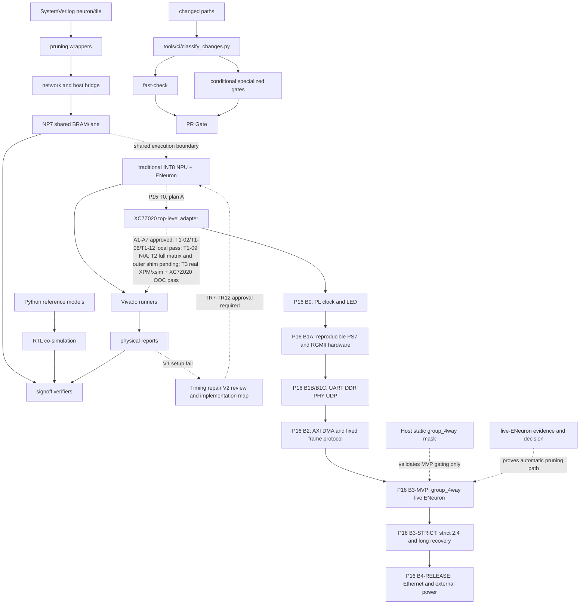

# 依赖关系

> generated_by: nexus-mapper v2 / manual synthesis
> verified_at: 2026-09-13
> provenance: Git checkout 身份以命令实时输出为准；板级签核仍绑定 RTL `be84596` 与对应 bit/XSA/ELF/manifest。

当前 B3 依赖（2026-09-13）：B3-MVP-GATE 已在 COM15 与 RTL `be84596` 的同源 bitstream 上关闭；dense/full-open/static/live 数值、epoch、execute/skip 与局部周期已有证据。当前并行依赖是 `B3-SPEED-GATE` 和 `B3-POWER-MEASURED/B3-POWER-GATE`，二者都通过后才关闭 `B3-GOAL-GATE`。严格连接级 `2:4` 仍是独立 B3-08b/STRICT 实验。

当前依赖边界：`xc7z020clg484-2` NPU + ENeuron 动态剪枝是活动主线；`archive/legacy/` 不参与日常门。B3 速度/功耗目标不依赖完整 B2-GATE、严格连接级 `2:4`、10000 样本、完整恢复或网口。严格结构与长稳工作进入 `B3-STRICT-GATE`；外部板级功耗属于 B3-POWER，B4 只补网口发布及其负载差异。

当前阶段合同由 `docs/planning/NPU_ZYNQ7020_BOARD_VALIDATION_PHASE2_V1.md` 主导，P16 TODO 段提供当前执行层级。B3-MVP-GATE 已关闭；开发链并行推进速度和功耗目标，B2-06～B2-10/B2-GATE 可补齐网口发布证据。B3-STRICT 独立于日常目标，B4-RELEASE 不再依赖严格门。

B2-08 依赖更新（2026-09-12）：adapter 四流计数和 fence snapshot 已进入 `b2_npu_axis_top`，并由 `0x40430000` 只读 AXI-Lite 状态块供 JTAG/PS 读取；HEAD `88bec9e` 的 200 MHz routed build 已通过，COM15 读回 command/sample/response/result=`658/658`、`8/8`、`1/1`、`10 beats/1 packet`，fence snapshot valid。该部分证据解除“状态块不可读”阻塞，但不解除完整多 packet/error/reset ledger、B2-GATE 或 B3 数值等价门。

B2 观测依赖（2026-09-09）：官方双/单 `axi_stream_monitor:1.1` 顶层实验分别以 `WNS=-0.325 ns`、`WNS=-0.284 ns` 失败。提交 `e26c7c1` 的物理门禁已通过，但 `20260909T063702Z` 暴露旧配置 period=0、stall=0 的假阳性；`20260909T065258Z` 已由零 stall fail-closed 正确拒绝。当前配置为 `0x04030201`，首个输入后启动 phase，并在 `fifo_valid && !backpressure_stall && !m_axis_tready` 时冻结 phase 以保持 AXI VALID/payload；51/51 定向合同通过。正式 run `20260909T105109Z`（HEAD `f7f01b0`）及 recovery run `20260909T110436Z` 已通过 UART/JTAG/XSCT，压力=`10000/10000`、受控背压=`64/64`、连续回绕=`256/256` 帧、`rollovers=3`，recovery timeout/reset/passed/failed=`1/1/1/0`、sequence=`10329`、CRC32=`0xD3E3C978`；B2-03/B2-04/B2-05/B2-GATE 仍保持未完成，间歇/ready 恢复、错误注入和更完整逐帧 PL 观测仍待完成。

B1依赖（2026-09-09）：B0实板配置链 → B1A来源审计与可重建硬件定义 → B1B UART/DDR实板门 → B1C PHY/UDP与最终B1-GATE。B1B的正式UART和低地址1 MiB DDR已三次冷启动通过，下一板卡资格依赖是关闭`0x10000000`高地址异常；在此之前不能完成B1C最终签核或网络化B2/B4，但不阻塞已获授权的低地址 B2-MVP 回环。

当前校正（2026-09-07）：T3 真实 AMD XPM/xsim 与 XC7Z020 OOC 已在 `c2bc03f` 重跑通过；下方旧链路中的 `822cf93` 仅为历史快照。

generated_by: nexus-mapper v2 / manual synthesis
verified_at: 2026-09-12
provenance: Git HEAD `fe25a70`；`.nexus-map/raw/ast_nodes.json` hub analysis and Python imports；SystemVerilog依赖由文件树/手工检查推断。未提交 RTL 排除在签核源码身份之外。



```text
Python oracle → cosim runners → unittest/verifier
神经元 RTL → wrapper → Tile/network → Host bridge
local_prune_reference → local_prune wrappers/network → NP4B signoff
NP7 shared lane oracle → dense/sparse RTL → XSim/OOC runners → physical/evidence gates
Vivado Tcl/runner → reports → verify_goal
传统 NPU + ENeuron 集成材料包 → Python oracle 签核 → 单时钟 RTL 与随机门 → 旧 OOC setup 失败 → TR1-TR6 批准 → 四 DSP 三拍 RTL → 单时钟 8/8 + 固定 `20×100` + 完整 473 项 → DSP V1 OOC（恰好 4 DSP48E1，hold/route/DRC 通过，100 MHz setup `WNS=-0.673 ns / TNS=-6.462 ns / 22` 端点失败）→ `NPU_SINGLE_CLOCK_TIMING_REPAIR_V2` 审核与 `NPU_SINGLE_CLOCK_TIMING_REPAIR_V2_IMPLEMENTATION_MAP` → TR7-TR12 批准 → V2 OOC 100 MHz PASS → P15-T0 方案 A（128-bit 命令/响应 FIFO + 64-bit 样本 FIFO + 96-bit 结果 FIFO，AXI-Stream 在 FIFO 外）→ 只读审计形成 A1-A7 → 管理员批准 A1-A7，状态 `P15_T0_APPROVED / T1_RTL_AUTHORIZED` → T1-12 boundary、T1-06 fence testbench、TLAST N/A 文档与复现扩展已在 `e4d48dd` 纳入提交基线 → T2 六组参数化可变时钟及并发 epoch 切片已提交并通过 `(7,2)/(9,1)/(4,3)/(5,0)/(11,4)/(3,1)`：epoch=2 在旧样本计算期间发布，旧结果/下一 fence 仍为 active epoch=1，下一样本才为 epoch=2；T2 有限矩阵和固定种子随机矩阵已在 `ee6c25a` 通过；更广泛并发交错与外层 shim 仍待独立验收 → T3 真实 AMD XPM/xsim `RESULT=PASS` + XC7Z020 OOC `PHYSICAL_GATE=PASS`（Vivado 2024.1，HEAD=`c2bc03f`，`2467 LUT / 2301 FF / 6 RAMB36 / 1 RAMB18 / 4 DSP48E1`，外部 CDC 0，100 MHz setup/hold/route/DRC error 0）→ 第一次完整端到端跑通后才重新评审资源裁剪
变更路径 → `classify-changes` → fast/全仓/XPM/NP7 专项门 → 唯一 `PR Gate`
```

高扇入模块包括 `pulse_mini_reference.py`、`rtl_tile_cosim.py`、`pulse_mini_l2_reference.py`、`neuron_sim.py`、`local_prune_reference.py`、`network_sim.py` 和 `host_bridge_oracle.py`。AST 仅覆盖 Python；RTL→wrapper→network 方向是人工核对的结构依赖。

当前 B2 依赖更新（2026-09-10）：`074ed56` 已证明 egress BRAM 预取将瓶颈从 `output_index -> response_mem ENARDEN` 推进到 NPU `compute_unit_mask_latched -> compute_group_index` 控制路径，但 setup 仍差 `52 ps`。因此 packet path 实板、动态剪枝 A/B、吞吐/周期/功耗测量继续被时序门阻塞。
