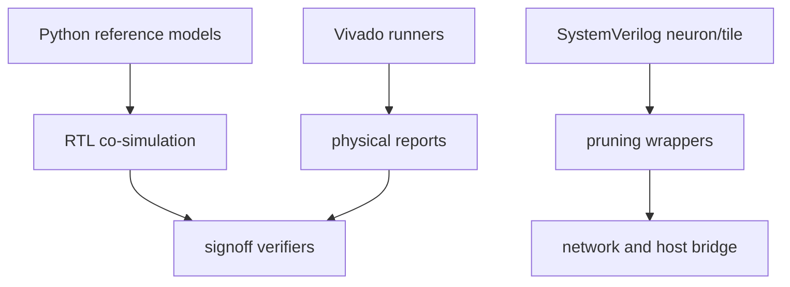

# 依赖关系

generated_by: nexus-mapper v2 / manual synthesis
verified_at: 2026-09-01
provenance: `.nexus-map/raw/ast_nodes.json` hub analysis and static imports



```text
Python oracle → cosim runners → unittest/verifier
神经元 RTL → wrapper → Tile/network → Host bridge
local_prune_reference → local_prune wrappers/network → NP4B signoff
Vivado Tcl/runner → reports → verify_goal
```

高扇入模块包括 `pulse_mini_reference.py`、`rtl_tile_cosim.py`、`neuron_sim.py` 和 `local_prune_reference.py`。
